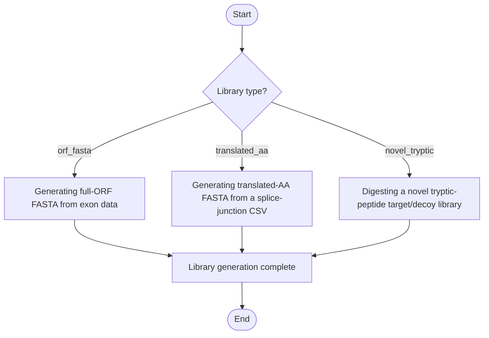

# Peptide Library Generator


## Installation

**[⬇️ Click here to install in Cauldron](http://localhost:50060/install?repo=https%3A%2F%2Fgithub.com%2Fnoatgnu%2Fpeptide-library-generator-plugin)** _(requires Cauldron to be running)_

> **Repository**: `https://github.com/noatgnu/peptide-library-generator-plugin`

**Manual installation:**

1. Open Cauldron
2. Go to **Plugins** → **Install from Repository**
3. Paste: `https://github.com/noatgnu/peptide-library-generator-plugin`
4. Click **Install**

**ID**: `peptide-library-generator`  
**Version**: 1.0.0  
**Category**: proteomics  
**Author**: CauldronGO Team

## Description

Generate a full-length ORF or translated-AA peptide library from exon/splicing data, or a novel tryptic-digest target/decoy library from any FASTA


## Workflow Diagram



## Runtime

- **Environments**: `python`

- **Entrypoint**: `peptide_library_generator.py`

## Inputs

| Name | Label | Type | Required | Default | Visibility |
|------|-------|------|----------|---------|------------|
| `library_type` | Library Type | select (Full ORF FASTA (from exon nucleotide sequence data), Translated AA FASTA (from a splice-junction CSV), Novel Tryptic Digest + Decoy (from any FASTA)) | Yes | orf_fasta | Always visible |
| `exon_data_file` | Exon Data File | file | No | - | Visible when `library_type` = `orf_fasta` |
| `chromosome_column` | Chromosome Column | text | No | chromosome | Visible when `library_type` = `orf_fasta` |
| `strand_column` | Strand Column | text | No | strand | Visible when `library_type` = `orf_fasta` |
| `gene_column` | Gene ID Column | text | No | gene | Visible when `library_type` = `orf_fasta` |
| `gene_name_column` | Gene Name Column | text | No | gene_name | Visible when `library_type` = `orf_fasta` |
| `id_column` | Row/Event ID Column | text | No | ID | Visible when `library_type` = `orf_fasta` |
| `sequence_inclusion_column` | Inclusion Sequence Column | text | No | sequence_inclusion | Visible when `library_type` = `orf_fasta` |
| `sequence_exclusion_column` | Exclusion Sequence Column | text | No | sequence_exclusion | Visible when `library_type` = `orf_fasta` |
| `exon_start_column` | Exon Start Column | text | No | exonStart_0base | Visible when `library_type` = `orf_fasta` |
| `exon_end_column` | Exon End Column | text | No | exonEnd | Visible when `library_type` = `orf_fasta` |
| `comparison_column` | Comparison Column | text | No |  | Visible when `library_type` = `orf_fasta` |
| `group_label_column` | Group Label Column | text | No |  | Visible when `library_type` = `orf_fasta` |
| `input_csv` | Translated Splice-Junction CSV | file | No | - | Visible when `library_type` = `translated_aa` |
| `cell_tag` | Cell/Dataset Tag | text | No | - | Visible when `library_type` is one of: `orf_fasta`, `translated_aa` |
| `source_fasta` | Source FASTA | file | No | - | Visible when `library_type` = `novel_tryptic` |
| `reference_fasta` | Reference FASTA | file | No | - | Visible when `library_type` = `novel_tryptic` |
| `miss_cleavage` | Missed Cleavages | number (min: 0, max: 5) | No | 2 | Visible when `library_type` = `novel_tryptic` |
| `max_length` | Maximum Peptide Length | number (min: 1, max: 200) | No | 30 | Visible when `library_type` = `novel_tryptic` |
| `min_length` | Minimum Length | number (min: 1, max: 200) | No | 7 | Always visible |

### Input Details

#### Library Type (`library_type`)

Which kind of peptide library to generate

- **Options**: `orf_fasta` (Full ORF FASTA (from exon nucleotide sequence data)), `translated_aa` (Translated AA FASTA (from a splice-junction CSV)), `novel_tryptic` (Novel Tryptic Digest + Decoy (from any FASTA))

#### Exon Data File (`exon_data_file`)

Exon-level data file (CSV or XLSX), one row per splicing event, with inclusion/exclusion nucleotide sequences. Required for the Full ORF FASTA type. Column names are mapped below; the defaults match rMATS's own AS_results column names.


#### Chromosome Column (`chromosome_column`)

Name of the column holding the chromosome. Only used for the Full ORF FASTA type.


#### Strand Column (`strand_column`)

Name of the column holding the strand. Only used for the Full ORF FASTA type.


#### Gene ID Column (`gene_column`)

Name of the column holding the gene ID/accession. Only used for the Full ORF FASTA type.


#### Gene Name Column (`gene_name_column`)

Name of the column holding the gene's display name. Only used for the Full ORF FASTA type.


#### Row/Event ID Column (`id_column`)

Name of the column holding a unique row/event identifier. Only used for the Full ORF FASTA type.


#### Inclusion Sequence Column (`sequence_inclusion_column`)

Name of the column holding the exon-inclusion nucleotide sequence. Only used for the Full ORF FASTA type.


#### Exclusion Sequence Column (`sequence_exclusion_column`)

Name of the column holding the exon-exclusion nucleotide sequence. Only used for the Full ORF FASTA type.


#### Exon Start Column (`exon_start_column`)

Name of the column holding the exon start coordinate. Only used for the Full ORF FASTA type.


#### Exon End Column (`exon_end_column`)

Name of the column holding the exon end coordinate. Only used for the Full ORF FASTA type.


#### Comparison Column (`comparison_column`)

Name of the column holding the comparison name used in FASTA header descriptions. Leave blank to auto-detect a column ending in '.l2fc'. Only used for the Full ORF FASTA type.


#### Group Label Column (`group_label_column`)

Optional column copied verbatim into the tracking table's Group.Label (e.g. an event-type label from the source tool). Leave blank to omit. Only used for the Full ORF FASTA type.


#### Translated Splice-Junction CSV (`input_csv`)

CSV with Transcript, AA_seq, genes, novel_junction_type, novel_junction_dpsi, NMD, and TSL columns, one row per already-translated isoform. Required for the Translated AA FASTA type.


#### Cell/Dataset Tag (`cell_tag`)

Short tag identifying this dataset, used in every FASTA header's unique ID. Required for the Full ORF FASTA and Translated AA FASTA types.


#### Source FASTA (`source_fasta`)

FASTA file to digest tryptically (e.g. the output of a prior Full ORF or Translated AA run). Required for the Novel Tryptic Digest type.


#### Reference FASTA (`reference_fasta`)

Reference proteome FASTA (e.g. canonical human UniProt) to check peptide novelty against. Required for the Novel Tryptic Digest type.


#### Missed Cleavages (`miss_cleavage`)

Number of missed cleavages to allow when digesting. Only used for the Novel Tryptic Digest type.


#### Maximum Peptide Length (`max_length`)

Maximum peptide length to keep. Only used for the Novel Tryptic Digest type.


#### Minimum Length (`min_length`)

Minimum peptide/sequence length to keep, for whichever library type is selected


## Outputs

| Name | File | Type | Format | Description |
|------|------|------|--------|-------------|
| `orf_fasta` | `orf_library.fasta` | data | fasta | Full-ORF peptide FASTA, one entry per translated exon inclusion/exclusion event and frame. Present only for the Full ORF FASTA type. |
| `orf_tracking` | `orf_tracking.tsv` | data | tsv | Tracking table for the Full ORF FASTA: gene, source file, event, frame, genomic location, and duplicate-sequence annotation for every entry. Present only for the Full ORF FASTA type. |
| `translated_aa_fasta` | `translated_aa_library.fasta` | data | fasta | Full-length translated-AA peptide FASTA, one entry per novel-junction transcript isoform. Present only for the Translated AA FASTA type. |
| `translated_aa_tracking` | `translated_aa_tracking.tsv` | data | tsv | Tracking table for the Translated AA FASTA: transcript, gene, junction type, dPSI, NMD, and TSL annotation for every entry. Present only for the Translated AA FASTA type. |
| `novel_target` | `novel_peptides_target.fasta` | data | fasta | Target FASTA of tryptic peptides from the source FASTA that are novel relative to the reference FASTA. Present only for the Novel Tryptic Digest type. |
| `novel_decoy` | `novel_peptides_decoy.fasta` | data | fasta | Decoy FASTA (reversed sequences, REVERSE_-prefixed headers) matching novel_target. Present only for the Novel Tryptic Digest type. |

## Requirements

- **Python Version**: >=3.10

### Python Dependencies (External File)

Dependencies are defined in: `requirements.txt`

- `pandas>=2.0.0`
- `openpyxl>=3.1.0`

> **Note**: When you create a custom environment for this plugin, these dependencies will be automatically installed.

## Example Data

This plugin includes example data for testing:

```yaml
  library_type: orf_fasta
  exon_data_file: examples/as_results/AS_results_fpkm_JCEC_SE_human.seq.deseq.csv
  cell_tag: demo
  min_length: 7
```

Load example data by clicking the **Load Example** button in the UI.

## Usage

### Via UI

1. Navigate to **proteomics** → **Peptide Library Generator**
2. Fill in the required inputs
3. Click **Run Analysis**

### Via Plugin System

```typescript
const jobId = await pluginService.executePlugin('peptide-library-generator', {
  // Add parameters here
});
```
